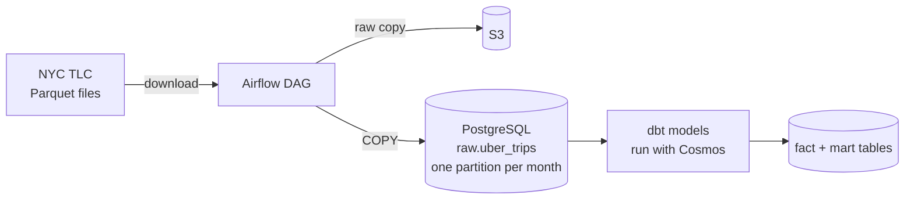

# NYC Congestion Pricing Data Pipeline


An Airflow pipeline that loads 90.5M NYC Uber trips into S3 and a partitioned PostgreSQL warehouse,
then models them with dbt to see what changed after NYC congestion pricing started.

## How it works



1. Once a month, the DAG checks that the TLC file for that month is published.
2. It downloads the Parquet file and uploads a raw copy to S3.
3. It loads only the Uber trips into that month's partition of `raw.uber_trips`.
4. dbt cleans the trips and builds the fact and mart tables. Cosmos runs each dbt model and test as its own Airflow task.

## Results

Data: https://www.nyc.gov/site/tlc/about/tlc-trip-record-data.page, Oct 2024 to Mar 2025, 90,527,002 Uber trips. I removed 51,741 bad trips.

Congestion pricing started on January 5, 2025. Trips that start or end in the Manhattan congestion zone (CBD) pay the fee.

| Trips per day | Before | After | Change |
|---|---|---|---|
| CBD trips | 167,944 | 161,494 | -3.8% |
| Other trips | 332,493 | 331,917 | -0.2% |

| Driver share of the fare | Before | After |
|---|---|---|
| CBD trips | 71.2% | 66.9% |
| Other trips | 83.5% | 80.2% |

CBD trips dropped about 3.8% while trips everywhere else stayed almost the same. Driver share dropped everywhere, so that part is probably not only because of congestion pricing. Manhattan had the lowest driver share (69.7%) and the Bronx had the highest (86.5%).

## Key decisions

- **Idempotent loads:** I partitioned the raw table by month, so re-running a month only reloads that month. I re-ran March and the count stayed at 14,547,181.
- **Least privilege:** `loader_role` can only write to `raw`, and `dbt_role` can only read `raw` and write to its own schema.
- **Validated the congestion zone:** I made my own list of the 38 taxi zones in the zone and checked it with the fee column. Almost every trip in those zones paid the fee after January 5.
- **Data quality tests:** A dbt test found 1,828 trips with negative driver pay, so I filtered them out.

## Run it

Requirements: Astro CLI, Docker, an S3 bucket with an IAM user that can access it.

1. Create a `.env` file with `POSTGRES_PASSWORD`, `POSTGRES_DB=warehouse`, `LOADER_PASSWORD`, `DBT_PASSWORD`, `S3_BUCKET`, `AWS_ACCESS_KEY_ID`, `AWS_SECRET_ACCESS_KEY` and `AWS_DEFAULT_REGION`.

2. Start Airflow and the warehouse:

```bash
astro dev start
```

3. Create the roles, schemas and raw tables:

```bash
set -a; source .env; set +a
docker exec -i $(docker ps -qf name=warehouse) psql -U postgres -d warehouse -v loader_pw="$LOADER_PASSWORD" -v dbt_pw="$DBT_PASSWORD" < include/sql/000_roles_and_schemas.sql
docker exec -i $(docker ps -qf name=warehouse) psql -U loader_role -d warehouse < include/sql/001_create_raw_tables.sql
```

4. In the Airflow UI (http://localhost:8080), add a Postgres connection called `warehouse_postgres` (host `warehouse`, port `5432`, database `warehouse`, login `dbt_role`, password = your `DBT_PASSWORD`).

5. Turn on the `rideledger_monthly` DAG. It backfills every month from Oct 2024 to Mar 2025.

Tests: `astro dev pytest`

## Project structure

```
dags/rideledger_monthly.py   Airflow DAG (ingest tasks + dbt task group)
dags/dbt/rideledger/         dbt project: models, macros, seeds, tests
include/rideledger/          download, S3 upload, Postgres load
include/sql/                 roles, schemas, partitioned raw table
tests/                       pytest tests (run in GitHub Actions on every push)
queries.sql                  first look at the data in DuckDB
```

## References

The dbt project and Cosmos setup are based on jayzern's dbt + Airflow tutorial ([video](https://www.youtube.com/watch?v=OLXkGB7krGo), [notes](https://bittersweet-mall-f00.notion.site/Code-along-build-an-ELT-Pipeline-in-1-Hour-dbt-Snowflake-Airflow-cffab118a21b40b8acd3d595a4db7c15)).